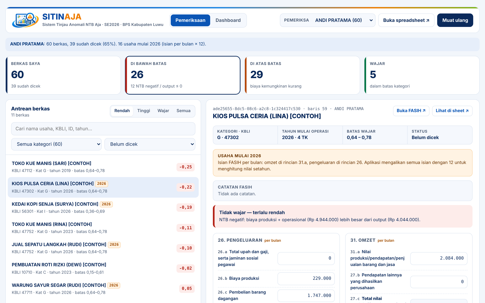

# SITINAJA — Sistem Tinjau Anomali NTB Aja

Web app Google Apps Script untuk memeriksa anomali rasio NTB hasil Sensus Ekonomi 2026, memantau progres pemeriksa, dan menyiapkan file koreksi format TUNTAS. Dikembangkan oleh **BPS Kabupaten Luwu (BPS-7317)**.

*Sitinaja* (bahasa Bugis) berarti pantas atau wajar.



## Fitur

- **Pemeriksaan**: antrean berkas per pemeriksa, saring per kategori dan status, rincian pengeluaran/pendapatan seperti urutan FASIH, catatan FASIH, hitungan rasio NTB langsung, saran perbaikan, dan remark #0–#4.
- **Dashboard**: target, selesai, sisa, selesai per hari, dan target harian per pemeriksa.
- **Log Koreksi**: setiap hasil cek otomatis tercatat dalam format Template TUNTAS dan bisa diunduh sebagai `.xlsx` dari Dashboard.
- Usaha yang mulai beroperasi 2026 (isian per bulan) dikali 12 untuk nilai setahun; Log Koreksi menulis nilai per bulan ke variabel r30*/r31*.

## Rumus

```
Output        = pendapatan barang/jasa − pembelian barang dagangan
Biaya antara  = biaya produksi + biaya operasional
NTB           = Output − Biaya antara
Rasio         = NTB ÷ Output   (wajar bila di dalam batas kategori)
```

Batas per kategori diambil dari Rekap Anomali Tahap 1 dan diatur di `CONFIG.BATAS_KATEGORI`.

**Saran perbaikan** hanya pembanding, bukan jawaban. Target rasio diacak di dalam batas (condong ke sisi yang dilanggar, tetap sama untuk usaha yang sama), dibulatkan ke ribuan rupiah, dan hanya mengubah satu kelompok isian. Tombol *Terapkan* hanya mengisi kolom; pemeriksa tetap memutuskan berdasarkan catatan atau konfirmasi.

## Isi repositori

| File | Isi |
| --- | --- |
| `src/Code.gs` | Kode server (Apps Script) |
| `src/Index.html` | Tampilan web app |
| `src/appsscript.json` | Manifest: izin akses dan pengaturan web app |
| `docs/` | Tangkapan layar (data contoh fiktif) |

## Data yang dibutuhkan

Satu spreadsheet berisi sheet **Database** (satu baris per usaha) dengan kolom berikut. Nama kolom tidak peka huruf besar/kecil.

| Kolom | Keterangan |
| --- | --- |
| `assignment_id`, `nama_usaha` | Wajib; satu assignment boleh berisi beberapa usaha |
| `link_fasih_sm` | Link dokumen FASIH (opsional) |
| `kategori`, `kode_kbli` | Kategori lapangan usaha (bila kosong, diturunkan dari KBLI) |
| `level_3_full_code`, `level_4_full_code` | Kode kecamatan dan desa |
| `tahun_operasi` | Tahun mulai operasi; 2026 = isian per bulan |
| `metrik_tenaga_kerja` | Jumlah tenaga kerja |
| `metrik_upah_gaji`, `metrik_biaya_produksi`, `metrik_biaya_pembelian`, `metrik_biaya_operasional`, `metrik_biaya_non_operasional` | Rincian pengeluaran (nilai setahun) |
| `metrik_pendapatan_barang_jasa`, `metrik_pendapatan_lainnya` | Rincian pendapatan (nilai setahun) |
| `metrik_total_pengeluaran`, `metrik_nilai_tambah`, `metrik_output`, `rasio_ntb` | Dihitung ulang saat disimpan |
| `Pemeriksa` | Nama pemeriksa tiap baris (mengisi pilihan nama di aplikasi) |

Kolom `Selesai`, `REMARK`, `DICEK_OLEH`, `WAKTU_CEK`, dan `NILAI_ASLI` dibuat otomatis bila belum ada. Catatan FASIH (opsional) dibaca dari sheet yang memiliki kolom `assignment_id`, `catatan_kunjungan_1..3`, `catatan_pml`, `catatan_umum`, dan `catatan_anomali_admin`.

## Pemasangan

1. Buka spreadsheet database satker Anda, lalu **Ekstensi → Apps Script**.
2. Ganti isi `Kode.gs` dengan isi `src/Code.gs`. Buat file HTML baru bernama `Index` (tanpa `.html`) dan tempel isi `src/Index.html`.
3. **Setelan proyek** (ikon roda gigi) → centang *Tampilkan file manifes "appsscript.json"* → ganti isinya dengan `src/appsscript.json`. Sesuaikan `timeZone` (WIB `Asia/Jakarta`, WITA `Asia/Makassar`, WIT `Asia/Jayapura`).
4. Ubah bagian `CONFIG` di `Code.gs`: `PEMILIK`, `KODE_SATKER`, `BATAS_WAKTU`, dan bila perlu nama sheet serta `DATAKEY`. Simpan (Ctrl+S).
5. Pilih fungsi `getMeta` → **Jalankan** → beri izin dan centang **Pilih semua**.
6. **Terapkan → Deployment baru → Aplikasi web**. *Jalankan sebagai*: Saya. *Yang memiliki akses*: Siapa saja yang memiliki Akun Google.
7. Bagikan link yang berakhiran `/exec` ke pemeriksa.

Memperbarui kode: **Terapkan → Kelola deployment → Edit → Versi baru → Terapkan**; link tidak berubah.

Kalau skrip dibuat di luar spreadsheet database, isi `CONFIG.SPREADSHEET_ID` dengan ID spreadsheet (bagian URL di antara `/d/` dan `/edit`).

## Sebelum unggah ke TUNTAS

- Cocokkan nama variabel di `CONFIG.DATAKEY` dan `CONFIG.DATAKEY_BULANAN` dengan tombol "Cari dataKey" di TUNTAS.
- Uji beberapa baris (termasuk #0 dan assignment berisi lebih dari satu usaha) dengan mode uji coba sebelum dijalankan massal.

## Keamanan data

- Repositori ini **hanya berisi kode**. Jangan pernah mengunggah spreadsheet, ekspor FASIH, atau tangkapan layar berisi data responden.
- Jangan menulis ID spreadsheet satker Anda di repositori publik.
- Jangan memilih akses *Siapa saja* (tanpa login). Bagikan link web app hanya ke tim pemeriksa.

## Atribusi dan lisensi

Kode dirilis dengan [Lisensi MIT](LICENSE). Silakan dipakai dan disesuaikan, dengan tetap mencantumkan atribusi **"SITINAJA · BPS Kabupaten Luwu (BPS-7317)"**, termasuk baris pengembang di bagian bawah halaman aplikasi.

Pertanyaan dan masukan: [nama dan kontak pengelola]
